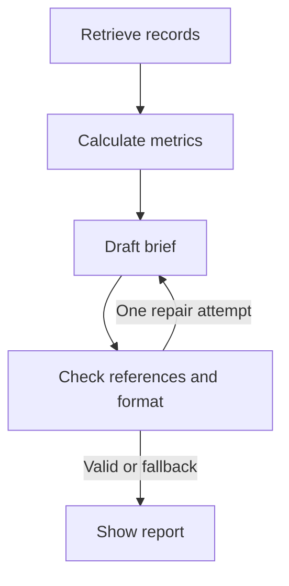

# Market Brief

A complete Python + vanilla JavaScript company-research app for Saith Ahmad's portfolio.
No-key demo mode uses clearly labelled synthetic data. Live mode combines SEC annual
financial facts, Alpha Vantage daily prices, Python calculations and Groq commentary.

## Run on Windows

Extract the project and open a terminal in `market-brief`. VS Code is optional.

```powershell
py -m venv .venv
.venv\Scripts\python -m pip install -r requirements.txt
.venv\Scripts\python -m uvicorn app.main:app --reload
```

Open **http://127.0.0.1:8000**. Sample mode opens immediately.

Linux/macOS: replace `.venv\Scripts\python` with `.venv/bin/python`.

## Enable live data

Copy `.env.example` to `.env` locally. On Render, set these in Environment settings.
Restart after changes. Never commit a real `.env` file or put keys in JavaScript.

| Variable | Purpose |
| --- | --- |
| `GROQ_API_KEY` | Your Groq key for AI commentary |
| `GROQ_MODEL` | Defaults to `openai/gpt-oss-20b` |
| `ALPHA_VANTAGE_API_KEY` | Your free daily-price API key |
| `SEC_USER_AGENT` | App name and real contact email, e.g. `MarketBrief me@example.com` |

Live mode requires Alpha Vantage and the SEC contact identifier. Without Groq it
shows actual provider records with clearly labelled rule-based commentary.
Failed live retrieval never silently substitutes synthetic data.

Keys: https://console.groq.com/keys · https://www.alphavantage.co/support/#api-key

## What it does

- Fetches up to 100 daily, unadjusted closing prices and volumes.
- Extracts annual revenue, net income, diluted EPS and operating cash flow from common SEC U.S.-GAAP tags.
- Selects actual year-long 10-K/10-K/A periods, aligns metric dates and uses the latest filed version.
- Calculates price changes, historical volatility, annual growth and net margin in Python.
- Links recent SEC filings without pretending their narrative text was analysed.
- Writes a concise evidence-linked brief with Groq when configured.
- Checks citation IDs and narrative format, retries an invalid model draft once, then falls back honestly.
- Exports a Markdown brief from the browser.

## Four readable nodes



This is a controlled research workflow, not an autonomous trading system.
Numerical claims stay in Python-calculated metric cards. Checking reference IDs
does **not** independently verify the truth of every model interpretation.

| File | Purpose |
| --- | --- |
| `static/index.html` | Page structure |
| `static/styles.css` | Responsive styling |
| `static/app.js` | API requests, chart, cards and downloads |
| `app/main.py` | FastAPI routes, cache and rate limits |
| `app/workflow.py` | LangGraph, Groq prompt and bounded repair |
| `app/sources.py` | Provider requests and evidence |
| `app/finance.py` | Financial periods and calculations |
| `app/demo.py` | Synthetic sample data |
| `app/models.py` | Explicit data shapes |
| `app/config.py` | Server configuration |

## Render free deployment

A pushed GitHub repo and your confirmed Render workspace are required.
Create one Web Service with these settings:

| Setting | Value |
| --- | --- |
| Runtime | Python |
| Plan | Free |
| Build | `pip install -r requirements-dev.txt && python -m pytest -q` |
| Start | `uvicorn app.main:app --host 0.0.0.0 --port $PORT --workers 1` |
| Health check | `/health` |
| Python version | `3.12.14` |

Add keys in Render's Environment page. Keep `LANGSMITH_TRACING=false`.
The no-key demo can deploy first. `render.yaml` also supplies a single-service Blueprint.

## Limits

- Standard Alpha Vantage free allowance: currently 25 requests/day. Each fresh price fetch uses one.
- Data/reports are cached for an hour. API limits are shared across visitors.
- Caches, budgets and request limits are in memory and reset on restart. Provider limits still apply.
- Render's free server can sleep after inactivity and take time to wake.
- V1 does not require a paid news feed, realtime quotes, Supabase, login or a database.
- Annual metrics may lag quarterly changes. Common U.S.-GAAP tags are supported; custom and IFRS tags are not.
- Unadjusted price changes are not total investment returns; splits/dividends can distort them.
- The Alpha Vantage source link documents the endpoint, not an independent public quote page.
- Sample mode never calls external providers or Groq.

## Test

```powershell
.venv\Scripts\python -m pip install -r requirements-dev.txt
.venv\Scripts\python -m pytest -q
```

Tests cover the API, invalid input, financial-period alignment, amended records,
negative bases, price math, citation rejection and bounded graph repair.
External Groq/provider calls need verification after real keys are configured.

The Render build runs the seven backend tests before starting the app. They cover
the real FastAPI routes and LangGraph execution with synthetic data and model
stubs; they do not call external providers. Three offline financial/report checks,
Python compilation and JavaScript syntax checks also passed locally.
Real Groq and market-provider calls still require verification after configuring
your keys. The demo never proves live-provider access.

Official references: https://render.com/docs/free · https://console.groq.com/docs/rate-limits ·
https://www.alphavantage.co/support/ · https://www.sec.gov/search-filings/edgar-application-programming-interfaces
